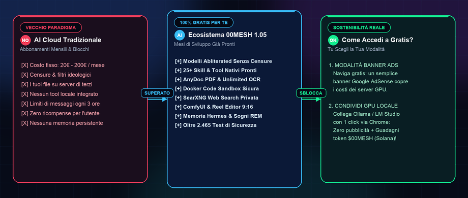
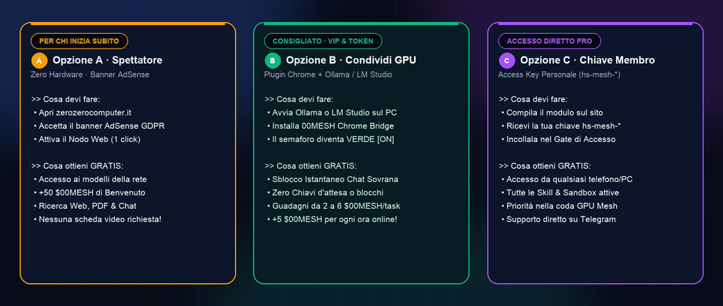
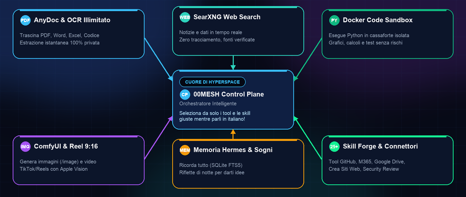
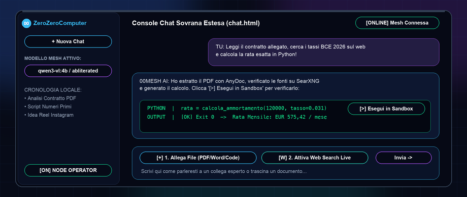
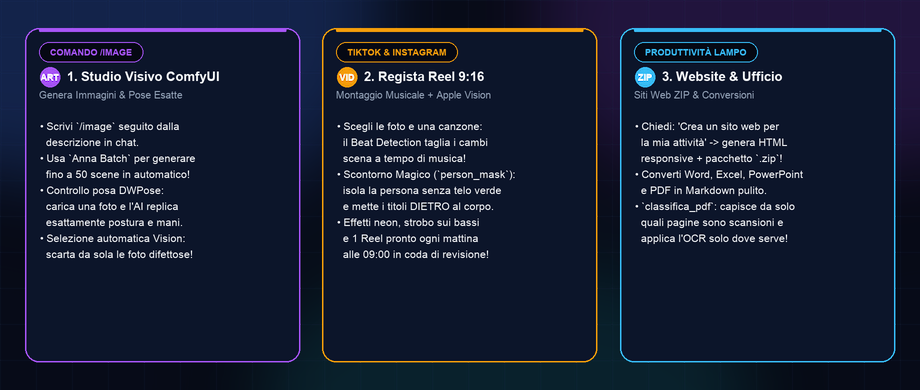
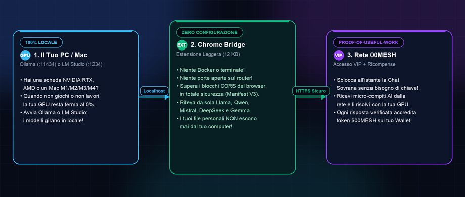
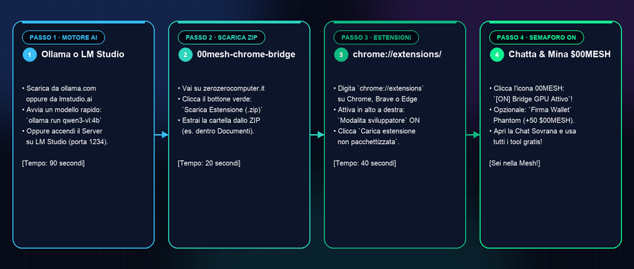
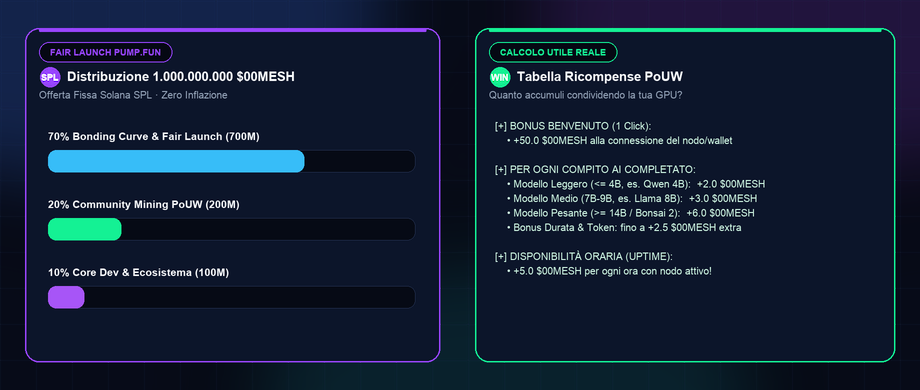

# 🚀 00MESH 1.05 — Guida Rapida & Presentazione Ufficiale
### *Come sfruttare GRATIS mesi di sviluppo AI, 25+ Skill e Tool professionali con un semplice Banner Pubblicitario o condividendo la tua GPU con Ollama / LM Studio*

> **🎯 Il Messaggio in 10 Secondi:**
> Mentre tutti ti chiedono **20€ o 200€ al mese** per usare chatbot chiusi, censurati e che leggono i tuoi affari privati, **ZeroZeroComputer** ha costruito **00MESH (HyperSpace 1.05)**: una centrale operativa di Intelligenza Artificiale Sovrana con **oltre 25 strumenti professionali già integrati**.
> E la parte migliore? **Per te è 100% GRATIS.** Non paghi con la carta di credito: la rete si sostiene con un semplice **banner pubblicitario etico** oppure **condividendo un pizzico della tua scheda video** quando non la usi (tramite **Ollama** o **LM Studio**), premiandoti pure con i token **`$00MESH`** su Solana!

📄 **Versione Slide PDF Widescreen (16:9) pronta da scaricare e presentare:**
👉 [**Scarica `00mesh-guida-rapida.pdf`**](00mesh-guida-rapida.pdf)

---

## 🌟 Slide 1 · Perché pagare abbonamenti quando hai 00MESH gratis?



### Cosa significa per te (spiegato in modo semplice e diretto):
* **Basta abbonamenti da 20€/mese:** Non devi inserire nessuna carta di credito.
* **Modelli "Abliterated" (Senza Censure o Paternalismi):** I modelli della rete 00MESH rispondono alle tue domande tecniche, creative e lavorative senza farti la morale e senza blocchi artificiali.
* **Mesi di sviluppo già pronti sotto il cofano:** Non hai davanti una semplice scatola vuota di chat, ma un intero **Sistema Operativo per Agenti** capace di leggere PDF, navigare sul web, eseguire codice Python in una stanza blindata, creare siti web e montare video verticali per TikTok e Instagram!

---

## 🚪 Slide 2 · Le 3 Porte di Accesso: Come fai a usare tutto a Gratis?

I computer che fanno girare l'Intelligenza Artificiale consumano energia elettrica e schede video costose. Come fa **00MESH** a offrirti tutto gratuitamente? Ti lascia **3 strade semplicissime**:



1. **🟡 OPZIONE A — Modalità "Spettatore Smart" (Con Banner Pubblicitario + Nodo Browser):**
   * **Per chi è:** Non hai una scheda video potente o sei su un portatile leggero? Nessun problema!
   * **Come funziona:** Accettando il banner pubblicitario (Google AdSense conforme al GDPR) sulle pagine informative e attivando con 1 click il **Nodo Web Browser**, le visualizzazioni pubblicitarie e i micro-compiti leggeri aiutano a pagare la corrente dei server GPU centrali.
   * **Il tuo vantaggio:** Usi l'AI gratis senza installare nulla sul computer e ricevi subito **+50 `$00MESH`** di benvenuto!

2. **🟢 OPZIONE B — Modalità "Condividi Calcolo GPU" (Con Ollama o LM Studio):**
   * **Per chi è:** Hai un PC con scheda video (es. NVIDIA RTX / AMD) o un Mac (M1/M2/M3/M4)? Per il 90% del tempo in cui navighi o guardi un film, la tua scheda video è ferma allo 0%.
   * **Come funziona:** Tieni aperto **Ollama** o **LM Studio** e aggiungi la nostra leggerissima **Estensione Chrome (`00mesh-chrome-bridge.zip`)**.
   * **Il tuo vantaggio:** **Sblocco istantaneo VIP della Chat Sovrana** (senza bisogno di chiavi d'accesso!) + guadagni token **`$00MESH`** ogni volta che la tua scheda video aiuta un altro utente della rete!

3. **🟣 OPZIONE C — Modalità "Chiave di Rete Membro" (`hs-mesh-*`):**
   * **Per chi è:** Vuoi entrare anche da smartphone, tablet o dal PC dell'ufficio?
   * **Come funziona:** Compili il modulo in fondo alla pagina `zerozerocomputer.it` e ricevi gratuitamente la tua chiave personale `hs-mesh-*`.

---

## 🧰 Slide 3 · Il Tuo Arsenale Segreto: 25+ Skill e Tool che si attivano da soli!

La domanda più frequente di chi inizia è: *"Ma devo imparare comandi complessi per usare tutti gli strumenti sviluppati in questi mesi?"*
**Risposta: ASSOLUTAMENTE NO!**



Dietro la chat lavora un meccanismo automatico chiamato **Hook `before_context`**. Mentre tu scrivi normalmente in italiano, lui legge le tue parole chiave e **innesta nel cervello dell'AI gli attrezzi giusti in meno di un millisecondo**:

| Cosa scrivi tu (in italiano normale) | Quale Super-Potere si accende da solo dietro le quinte |
|---|---|
| *"Leggi questo file PDF / Word / Excel"* | **📎 AnyDoc & PDF Inspector**: estrae tabelle e testo in Markdown pulito direttamente nel browser o col convertitore locale, e usa **Unlimited OCR** sulle scansioni cartacee! |
| *"Cerca le ultime notizie su..."* | **🔍 SearXNG Private Search**: interroga i motori di ricerca senza farti spiare dai cookie e ti mostra il box **Fonti Consultate** con i link veri cliccabili. |
| *"Leggi questa pagina: https://..."* | **🌐 Lettore Diretto `web_fetch`**: non inventa risposte! Apre davvero l'indirizzo web che hai incollato e ne legge il contenuto riga per riga. |
| *"Calcola / Scrivi un programma Python"* | **🐍 Docker Code Sandbox**: apre una cassaforte usa-e-getta, esegue il programma per davvero e ti mostra il risultato matematico certificato (`Exit 0`). |
| *"Controlla se questo codice è sicuro"* | **🛡️ Skill ECC `security-review` & `verification-loop`**: carica le regole di sicurezza firmate crittograficamente (SHA-256) per scovare bug e vulnerabilità. |
| *"Ricordati che il mio progetto..."* | **🧬 Memoria Hermes (`omega_store` / `omega_query`)**: salva i fatti nel database SQLite FTS5 a lungo termine. E di notte, col **Dream Loop**, l'AI rilegge i ricordi e prepara intuizioni per il mattino dopo! |
| *"Pianifica i passi di questo lavoro"* | **🗺️ Wayfinder & Mission Control**: scompone un obiettivo complesso in una mappa ordinata di compiti verificabili che non va mai in loop infinito. |

---

## 💬 Slide 4 · Guida Visiva alla Console Chat Sovrana (3 Bottoni e Sai Usare Tutto)

Quando apri **`chat.html`** (cliccando su *"💬 Apri Chat Estesa"*), ti trovi davanti una plancia chiarissima. Ecco cosa fanno i comandi principali:



1. **Selettore Modello (in alto a sinistra):** Scegli con quale cervello parlare (es. `qwen3-vl:4b-instruct` velocissimo a 95 token/sec, modelli *abliterated* senza filtri, oppure `Anna Batch diretto` per generare decine di immagini).
2. **Pulsante `📎 Allega File` (o trascina col mouse):** Trascina dentro la finestra qualsiasi documento (`.pdf`, `.txt`, `.md`, `.csv`, `.json`, `.py`, `.js`, `.html`). Il file viene letto all'istante e compare come una targhetta sopra il messaggio!
3. **Pulsante `🌐 Web Search`:** Cliccalo per accenderlo quando vuoi che l'AI cerchi fatti accaduti oggi stesso su internet.
4. **Pulsante `▶ Esegui in Sandbox` (dentro le risposte di codice):** Ogni volta che l'AI scrive un programma in Python, in alto a destra sul riquadro del codice appare il bottone **`▶ Esegui in Sandbox`**. Cliccalo e sotto si aprirà un vero terminale nero con il risultato reale dell'esecuzione!

---

## 🎨 Slide 5 · Creatività e Multimedia: Immagini, Reel TikTok 9:16 e Siti Web!

Non solo testo e ufficio: in 00MESH sono stati integrati mesi di sviluppo dedicati a chi crea contenuti social, siti web e grafica.



* **🎨 Generatore Immagini (`/image` e `Anna Batch`):**
  * Scrivi `/image` seguito da quello che vuoi vedere e i nodi GPU della rete (con **ComfyUI**) creano l'immagine per te.
  * Vuoi che il personaggio abbia **esattamente una posa del corpo e delle mani**? Il sistema integra **ControlNet DWPose** e un selezionatore visivo automatico (`qwen3-vl`) che controlla le immagini generate e **scarta da solo quelle venute male**!
* **🎬 Reel Editor Verticale 9:16 con Occhi Apple Vision:**
  * Hai foto o clip video e una canzone? Il tool `reel_prepare_project` prepara il montaggio verticale per TikTok, Instagram Reels e YouTube Shorts.
  * **Magia senza Green Screen:** Grazie a `person_mask.swift` (Apple Vision), il sistema ritaglia automaticamente la sagoma della persona e posiziona **i titoli karaoke luminosi DIETRO il soggetto** e i tagli esattamente a tempo con i battiti della cassa musicale!
* **🌐 Creatore di Siti Web (`create_website`):**
  * Chiedi in chat di creare una landing page o un sito vetrina per il tuo negozio o progetto: il tool genera il sito completo responsive e ti consegna il file **`.zip` pronto da pubblicare**!

---

## 🔌 Slide 6 · Come funziona la Condivisione GPU con Ollama o LM Studio?

Perché migliaia di appassionati stanno collegando il proprio PC o Mac a 00MESH? Perché è **il modo più intelligente di trasformare l'hardware che hai già pagato in un lasciapassare gratuito e remunerato**.



* **Il Problema che abbiamo risolto per te:** Di solito, per mettere in rete un computer servono competenze da ingegnere informatico (Docker, Linux, porte sul router, indirizzi IP).
* **La Soluzione 00MESH Chrome Bridge:** Abbiamo racchiuso tutto in una **minuscola estensione per Google Chrome, Brave o Edge (12 KB)**.
  * L'estensione parla da un lato con il tuo **Ollama** (`localhost:11434`) o **LM Studio** (`127.0.0.1:1234`) sul tuo computer.
  * Dall'altro lato parla in HTTPS crittografato con il Gateway 00MESH.
  * **Sicurezza Totale:** L'estensione **NON può leggere i tuoi file personali**. Riceve solo una domanda di testo, la fa risolvere alla tua scheda video e restituisce la risposta, accreditandoti i punti!

---

## 🛠️ Slide 7 · Mini Guida di Installazione Passo-Passo (In 3 Minuti!)

Anche se non hai mai installato un'estensione manuale prima d'ora, segui questi **4 passi illustrati** e sarai operativo in meno di 3 minuti:



### Passo 1 · Accendi il tuo motore AI locale (Ollama o LM Studio)
* **Se scegli Ollama (Consigliato, leggerissimo):**
  1. Vai su [ollama.com](https://ollama.com), scarica il programma per Windows, Mac o Linux e installalo con due click.
  2. Apri il Terminale (o Prompt dei comandi) e incolla questo singolo comando per scaricare un modello veloce e intelligente:
     ```bash
     ollama run qwen3-vl:4b-instruct
     ```
  3. Fatto! Ora vicino all'orologio del tuo computer c'è l'iconcina del lama: significa che è attivo sulla porta `11434`.
* **Se preferisci LM Studio (Tutto grafico col mouse):**
  1. Scarica [lmstudio.ai](https://lmstudio.ai), cerca un modello qualsiasi (es. *Qwen*, *Llama 3* o *Mistral*) e scaricalo.
  2. Clicca sull'icona **`<->` (Local Server)** a sinistra e premi il pulsante verde **Start Server** (porta `1234`).

### Passo 2 · Scarica il pacchetto dell'Estensione 00MESH
1. Vai sulla pagina principale di **00MESH** (`zerozerocomputer.it`).
2. Clicca sul bottone verde **`⬇️ Scarica Estensione (.zip)`** (il file si chiama `00mesh-chrome-bridge.zip`).
3. Fai doppio click sul file `.zip` scaricato per **estrarre la cartella** (mettila ad esempio nella tua cartella *Documenti* così non la cancelli per sbaglio).

### Passo 3 · Carica l'Estensione nel tuo Browser (Chrome, Brave o Edge)
1. Apri una nuova scheda del browser, clicca nella barra degli indirizzi in alto, scrivi esattamente questo e premi Invio:
   ```text
   chrome://extensions/
   ```
2. Guarda **in alto a destra**: troverai un interruttore chiamato **"Modalità sviluppatore"** (*Developer mode*). **Cliccalo per attivarlo!**
3. Ora **in alto a sinistra** sono apparsi tre nuovi bottoni: clicca sul primo, **`Carica estensione non pacchettizzata`** (*Load unpacked*).
4. Seleziona la cartella `00mesh-chrome-bridge` che hai estratto al Passo 2 e conferma.

### Passo 4 · Semaforo Verde 🟢, Wallet e Chat Sbloccata!
1. Clicca sull'icona del puzzle 🧩 in alto a destra su Chrome e fissa l'icona **00MESH Bridge**.
2. Cliccandoci sopra vedrai che **ha già trovato da sola Ollama o LM Studio** e i tuoi modelli!
3. Torna su `zerozerocomputer.it`: il riquadro di accesso diventerà subito verde (**`🟢 Bridge GPU Attivo`**) e il bottone **`💬 Apri Chat Estesa Sovrana ↗`** sarà completamente sbloccato!

---

## 🪙 Slide 8 · Tokenomics `$00MESH`: Guadagna Condividendo la Tua Potenza!

Ogni volta che il tuo browser o la tua scheda video sono connessi, partecipi alla **Proof-of-Useful-Work (PoUW)**:



* **🎁 +50.0 `$00MESH` Subito al Primo Collegamento:** Ti basta inserire il tuo indirizzo Solana (wallet gratuito **Phantom** o **Solflare**) e cliccare su **`🟣 Firma Wallet`** per ricevere all'istante il bonus di benvenuto!
* **⚡ Ricompense ad Ogni Risposta AI (Task):**
  * **+2.0 `$00MESH`** per task con modelli leggeri ($\le 4\text{B}$ parametri).
  * **+3.0 `$00MESH`** per task con modelli intermedi ($7\text{B}-9\text{B}$ parametri).
  * **+6.0 `$00MESH`** per task con modelli avanzati ($\ge 14\text{B}$ / MoE / Ternary Bonsai 2).
  * **+5.0 `$00MESH` ogni ora** semplicemente per tenere il nodo acceso e disponibile!
* **🟣 Fair Launch su pump.fun (Solana SPL):** Su **1.000.000.000** di token totali fissi, **200.000.000 `$00MESH` (il 20%)** sono riservati esclusivamente alla Community Pool per chi ha condiviso calcolo nella rete!

> *Nota legale di trasparenza (MiCA UE 2023/1114): `$00MESH` è un utility token sperimentale e un sistema di punti computazionali per premiare il calcolo utile condiviso nella rete di ricerca 00MESH, non un prodotto finanziario speculativo o una promessa di rendita garantita.*

---

## 📋 Riepilogo Veloce: Quali Prompt Provare Subito?

Appena entri nella Chat Sovrana, prova uno di questi 5 comandi per toccare con mano mesi di sviluppo:

1. **Testa la Sandbox Python:**
   > *"Scrivi uno script Python che calcola i primi 50 numeri della serie di Fibonacci, mostra il tempo di calcolo in millisecondi e verifica che funzioni."* *(Poi clicca su `▶ Esegui in Sandbox`!)*
2. **Testa la Ricerca Web Privata:**
   > *(Accendi `🌐 Web Search`)* *"Quali sono le ultime novità di questa settimana sui modelli AI open-source? Citami le fonti."*
3. **Testa l'Analisi Documenti AnyDoc:**
   > *(Trascina un PDF qualsiasi nella chat)* *"Fammi un riassunto in 5 punti chiave e dimmi se ci sono clausole a cui fare attenzione."*
4. **Testa il Creatore di Siti Web:**
   > *"Usa il tool create_website per creare una landing page moderna per uno studio fotografico a Milano chiamato LucePura."*
5. **Testa la Generazione Immagini:**
   > *"/image un astronauta che legge un libro olografico in una biblioteca futuristica immersa nella natura, stile cinematografico 8k"*
