# HyperSpace AGI 1.05 — Presentazione Divulgativa & Grafiche Esplicative

Presentazione per la release **HyperSpace AGI 1.05**.
Versione PDF generata ad alta risoluzione con ReportLab 4.5.1: [**hyperspace-1.05-presentation.pdf**](hyperspace-1.05-presentation.pdf) (12 slide widescreen 16:9 con grafiche esplicative integrate).
Script di build riproducibile: `scripts/generate_hyperspace_presentation.py`.

---

## Slide 1 · Copertina: Il Futuro dell'Intelligenza Artificiale che Lavora Davvero
*L'Intelligenza Artificiale che Lavora Davvero: Dai Chatbot ai Sistemi Operativi per Agenti Autonomi Governative*

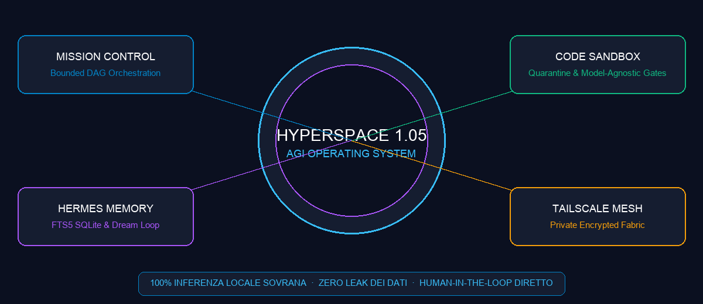

- **Zero Allucinazioni Applicate**
- **Stanza Ermetica (Sandbox)**
- **Memoria & Sogni Notturni**
- **100% Locale e Privato**
- **Video & Visione Neurale**
- **Oltre 2.300 Test di Sicurezza**

---

## Slide 2 · Il Nuovo Paradigma: Oltre i Chatbot
*I modelli linguistici sono brillanti ma caotici. HyperSpace è il telaio che li rende sicuri per il mondo reale.*

### Spiegazione Divulgativa
- **L'Intuizione Chiave**: Un'AI lasciata libera in chat è come un'automobile potente senza freni: può generare idee brillanti, ma se le dai accesso al computer rischia di cancellare file per errore, inventare fatti inesistenti o bloccarsi in loop infiniti consumando risorse.
- **Come Cambia Tutto con HyperSpace**: HyperSpace non lascia mai l'AI agire direttamente sul tuo computer. Costruisce una torre di controllo (Control Plane) e una stanza ermetica: ogni compito ha regole rigide, permessi espliciti e un budget massimo prefissato.
- **Il Tuo Vantaggio Diretto**: Ottieni tutta la potenza operativa dell'AI per automatizzare il lavoro reale, ma con la certezza matematica che nessun dato sensibile verrà corrotto e nessun codice verrà applicato senza la tua esplicita autorizzazione.

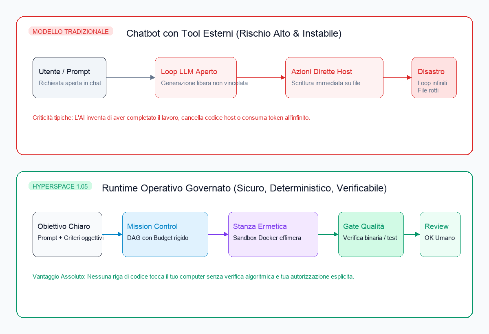

---

## Slide 3 · Orchestrazione Intelligente: Mission Control
*Mission Control: Il Direttore d'Orchestra dell'AI — Trasformare grandi obiettivi in compiti certi e verificabili.*

### Spiegazione Divulgativa
- **Il Problema dei Compiti Grandi**: Se chiedi a un normale assistente AI: *"Analizza questo progetto, scrivi il programma, fai i test e crea un PDF"*, si distrae, salta passaggi o dichiara falsamente di aver finito.
- **Il Principio del DAG Bounded**: Mission Control applica il principio del *Divide et Impera*: scompone l'obiettivo in un albero ordinato di compiti (DAG). Assegna ciascun compito a un ruolo specialistico (l'Analista legge solo, il Coder programma in sandbox, il Verificatore controlla).
- **Garanzia di Terminazione (Stop ai Loop)**: Ogni missione ha tetti massimi invalicabili su passi totali, tempo e token. Se un compito incontra un vicolo cieco, non continua a girare a vuoto: si arresta in modo ordinato, spiega il motivo e cerca una via alternativa.

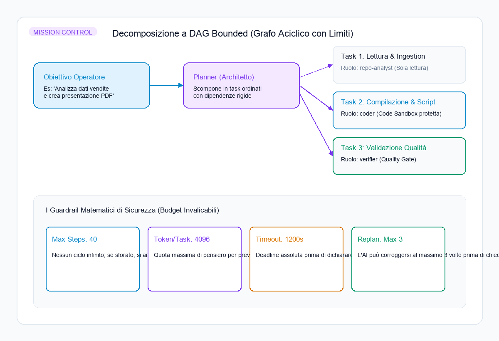

---

## Slide 4 · Sicurezza & Esecuzione Isolata: La Stanza Ermetica
*La Stanza Ermetica: Nessun Codice Tocca il Tuo Computer — Sandbox usa-e-getta e controlli oggettivi indipendenti.*

### Spiegazione Divulgativa
- **Il Rifiuto dell'Auto-Certificazione**: Spesso i modelli linguistici rispondono: *"Ho eseguito tutto con successo!"* anche se il file è corrotto o non è mai stato creato. HyperSpace rifiuta categoricamente l'auto-certificazione dell'AI.
- **La Stanza Ermetica (Sandbox Docker)**: L'agente lavora esclusivamente all'interno di una sandbox virtuale isolata usa-e-getta. Se genera codice sbagliato o comandi errati, si rompe solo l'ambiente virtuale temporaneo: il tuo computer host rimane intoccabile.
- **I 3 Cancelli di Controllo Oggettivi (Gate)**: Prima di mostrarti il risultato, intervengono validatori matematici esterni: ispezionano i byte effettivi del file (es. `%PDF` reale), controllano la sintassi del codice e pretendono il superamento al 100% dei test automatici.

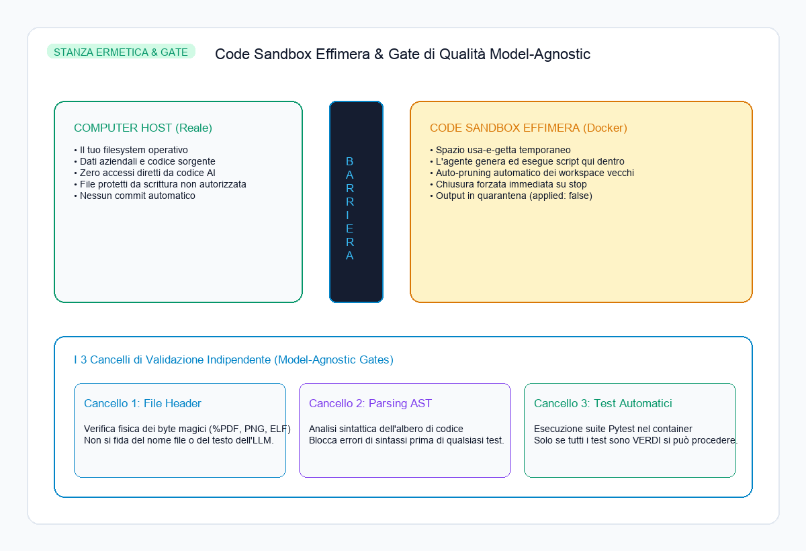

---

## Slide 5 · Il Laboratorio delle Abilità: Forge & Hook Adattivi
*Forge & Hook Adattivi: Come l'AI Impara Nuovi Tool — Blocco crittografico e attivazione automatica al momento giusto.*

### Spiegazione Divulgativa
- **Perché Creare Nuove Abilità?**: Un sistema bloccato su strumenti fissi invecchia subito. HyperSpace permette agli agenti di sintetizzare nuove abilità (skill) e strumenti personalizzati quando affrontano problemi inediti.
- **Il Blocco di Sicurezza a Due Fasi**: Per evitare che l'AI esegua codice non autorizzato, ogni nuova abilità nasce come una **Bozza Inerte**. Rimane sigillata con un lucchetto finché non viene ispezionata e firmata con un'impronta crittografica **SHA-256**.
- **Iniezione Intelligente 'before_context'**: Non intasiamo la memoria con decine di istruzioni inutili: un selettore automatico legge le parole chiave dell'utente (es. *sicurezza*, *PDF*, *URL*) e carica al massimo 2 abilità necessarie (tetto rigido di 24 KB), evitando sprechi di token.

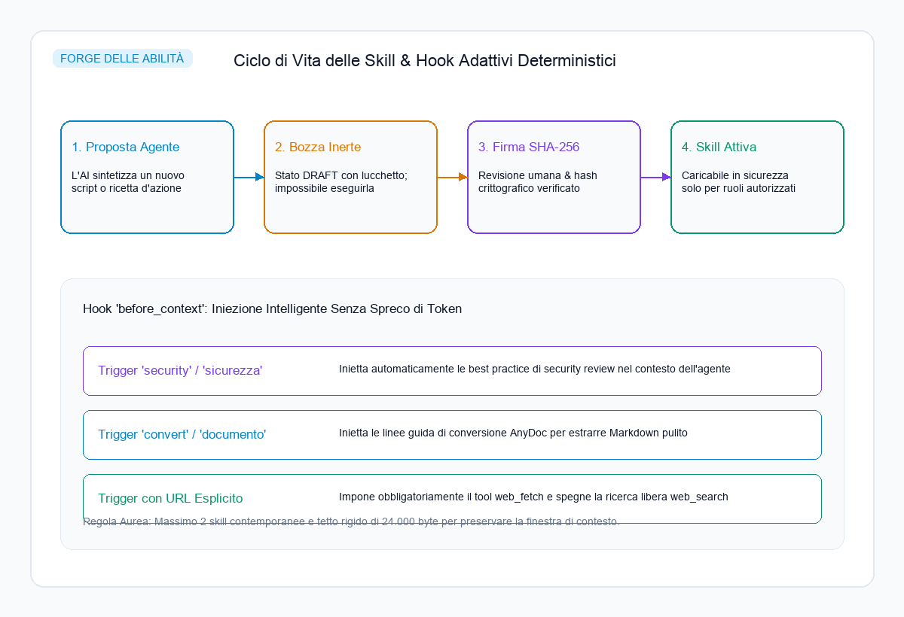

---

## Slide 6 · Memoria Viva & Riflessione: Memoria Hermes & Sogni Notturni
*Memoria Hermes & Sogni Notturni: Il Sonno REM dell'AI — Ricordare tutto e riflettere durante i momenti di riposo.*

### Spiegazione Divulgativa
- **Superare l'Amnesia dei Chatbot**: I normali chatbot dimenticano tutto non appena chiudi la finestra. HyperSpace utilizza Hermes come memoria unica duratura (database SQLite FTS5 ultra-veloce e file Markdown canonici).
- **Il Sonno REM dell'AI (Dream Loop)**: Cosa fa il sistema quando non stai lavorando o durante la notte? Entra in fase di **Sogno** (idle-only): rilegge le memorie recenti, trova collegamenti inaspettati tra compiti diversi e prepara sintesi utili per il giorno dopo.
- **Quarantena delle Ipotesi & Preemption**: Le intuizioni notturne restano "ipotesi": NON modificano la memoria ufficiale finché tu non le confermi. E se scrivi un messaggio mentre l'AI sta sognando? Il sogno si ferma all'istante in pochi millisecondi!

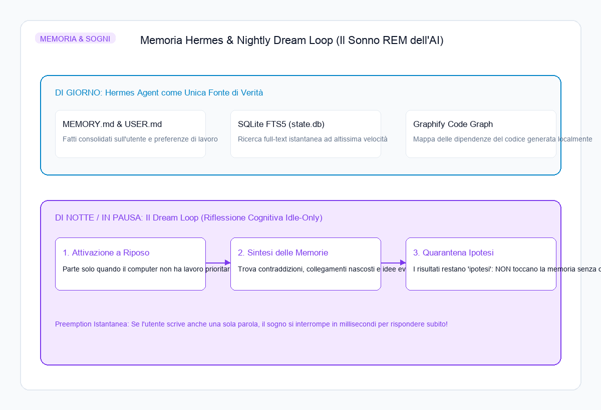

---

## Slide 7 · Rete Distribuita: La Rete Nervosa Privata
*La Rete Nervosa Privata: Più Computer, Una Sola Mente — Mac, PC Windows, Linux e browser in una mesh privata cifrata.*

### Spiegazione Divulgativa
- **Il Valore dell'Hardware che Già Possiedi**: Invece di pagare costosi abbonamenti cloud per ogni singolo modello, HyperSpace unisce tutti i tuoi computer in un'unica rete neurale privata coordinata dal Control Plane.
- **Specializzazione Hardware Dinamica**: Ciascun dispositivo fa ciò in cui eccelle: il **Mac Studio** usa Neural Engine e Metal per video e audio ultra-veloci; il **PC Windows** usa la GPU RTX per la grafica pesante; il **Server Linux** esegue modelli linguistici aperti con Ollama a zero costi.
- **Privacy Totale via Tailscale Mesh**: Tutti i nodi comunicano tra loro con una VPN peer-to-peer crittografata (WireGuard). Non serve aprire porte sul router aziendale e nessun dato transita su server cloud di terze parti.

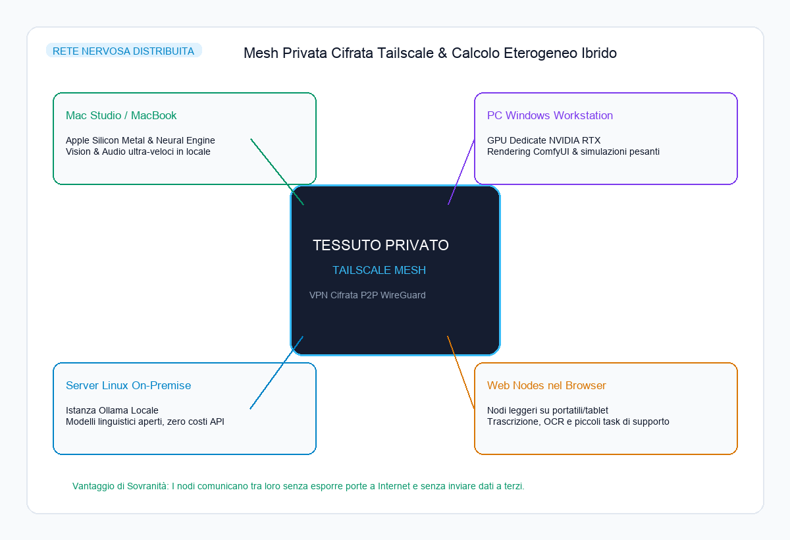

---

## Slide 8 · Produzione Video Intelligente: Reel Editor & Apple Vision
*Reel Editor: Il Regista Virtuale con Occhi Apple Vision — Video verticali 9:16 a tempo con segmentazione Swift su Mac.*

### Spiegazione Divulgativa
- **L'Esigenza del Contenuto Verticale**: Creare video di qualità per TikTok, Instagram Reels e YouTube Shorts richiede ore di lavoro manuale: allineare i tagli alla musica, isolare le persone e sincronizzare i testi.
- **Visione Neurale Swift su macOS**: Grazie a un modulo nativo in Swift (`person_mask.swift`) integrato con Apple Vision, il Mac isola la figura umana in tempo reale **senza green screen**: permette di posizionare titoli karaoke (rame/avorio) ed effetti particellari *dietro* al soggetto!
- **Il Reel Giornaliero in Coda di Revisione**: Un demone programmato (LaunchAgent) analizza il ritmo musicale con Beat Detection e monta un nuovo video ogni mattina alle 09:00: il video ti aspetta nella cartella di revisione, pronto per il tuo ok prima della pubblicazione.

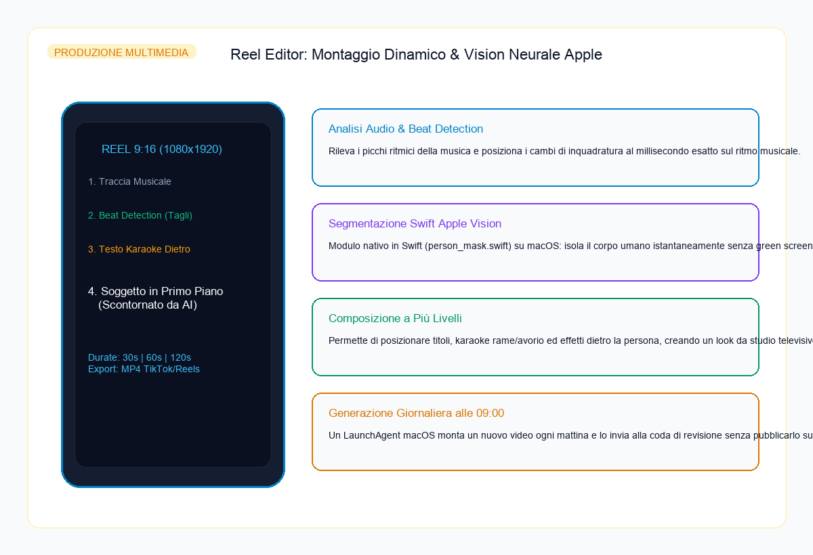

---

## Slide 9 · Automazione Documentale: HyperSpace Ufficio
*HyperSpace Ufficio: AnyDoc, OCR Illimitato e Connettori M365 — Dalle scansioni all'integrazione fluida con Microsoft 365.*

### Spiegazione Divulgativa
- **Il Labirinto Documentale**: Gli uffici moderni sono sommersi da contratti cartacei scansionati, PDF complessi con tabelle intricate e documenti sparsi in decine di cartelle.
- **AnyDoc & Unlimited OCR Offline**: HyperSpace converte qualsiasi file (PDF, Word, fogli di calcolo, scansioni cartacee) in testo pulito Markdown strutturato. L'OCR gira interamente in locale: non paghi nulla a consumo e non invii documenti riservati a terzi.
- **Connettori Sicuri Zero-Leak**: Integrazione diretta con **Microsoft 365**, **Google Workspace**, **GitHub** e OnlyOffice per lavorare sui documenti direttamente nel browser. Tutte le credenziali e password vengono cancellate e redatte automaticamente da ogni traccia di log.

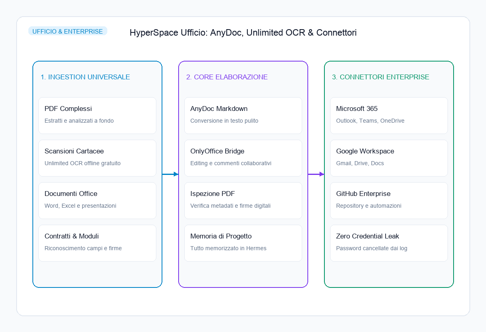

---

## Slide 10 · Ingegneria del Software: La Torre di Controllo Multi-Agente
*La Torre di Controllo: Più Agenti AI sullo Stesso Progetto — Collaborazione multi-agente sul codice senza conflitti.*

### Spiegazione Divulgativa
- **La Sfida della Convivenza**: Cosa succede quando più programmatori AI operano sullo stesso computer? Senza regole, si sovrascrivono il codice a vicenda, cancellano modifiche recenti e creano caos nel repository.
- **La Costituzione e il Diario di Bordo**: In HyperSpace vigono due regole ferree: `AGENTS.md` stabilisce esattamente chi può toccare cosa; `AGENT-LOG.md` è un diario di bordo in cui ogni agente legge cosa è stato fatto prima di agire e firma il proprio operato alla fine.
- **Lo Scudo dei 2.300 Test Automatici**: Una gigantesca suite di oltre 2.315 test automatici vigila continuamente sull'integrità del sistema: se un agente commette un errore, i test lo bloccano all'istante prima che il danno si propaghi.

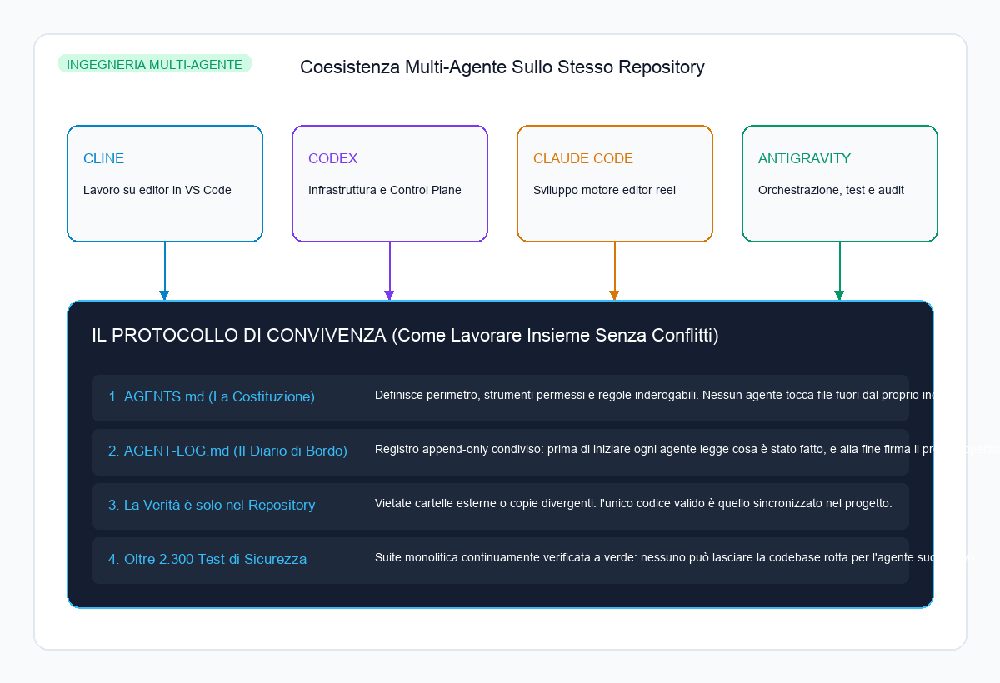

---

## Slide 11 · Applicazioni & Mercato: 4 Soluzioni Concrete
*Quattro Soluzioni ad Alto Valore Pronte all'Uso — Dalla teoria al fatturato immediato per aziende, dev, uffici e creator.*

### I Quattro Pacchetti
- **1. Enterprise Local (Privacy Assoluta)**: Banche, sanità, studi legali, PA. Agenti su dati riservati on-premise, zero fuga di dati all'estero, audit trail crittografico.
- **2. Agent Operations Platform (Per Dev Team)**: Software house e team tecnologici. Risoluzione autonoma ticket e refactoring in sandbox usa-e-getta.
- **3. HyperSpace Ufficio**: Studi professionali e PMI. Gestione documentale totale, OCR infinito, OnlyOffice bridge, memoria condivisa di studio.
- **4. HyperSpace Multimedia**: Media house e creator. Montaggio ritmico automatico 9:16, person segmentation Apple Vision, personaggi virtuali coerenti (Anna/Aurora).

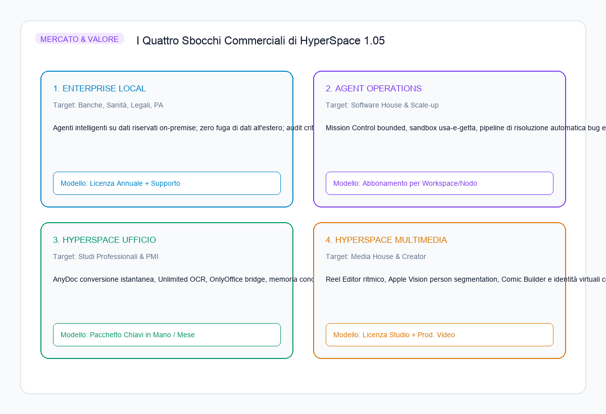

---

## Slide 12 · Conclusione & Visione: L'Intelligenza Artificiale che Lavora Davvero
*HyperSpace 1.05 non è una promessa astratta né una chat superficiale: è un runtime solido, sicuro e pronto all'uso aziendale.*

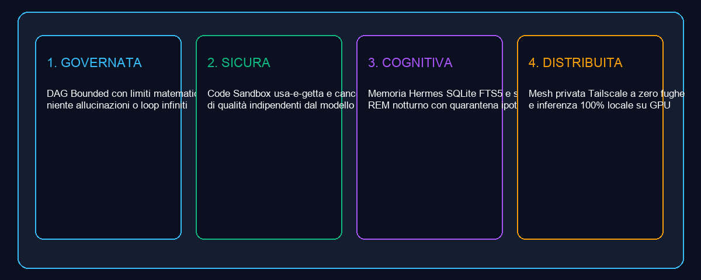

Le 5 colonne portanti:
1. **Governata**: DAG Bounded con limiti matematici; niente allucinazioni o loop infiniti.
2. **Sicura**: Code Sandbox usa-e-getta e cancelli di qualità indipendenti dal modello.
3. **Cognitiva**: Memoria Hermes SQLite FTS5 e sonno REM notturno con quarantena ipotesi.
4. **Distribuita**: Mesh privata Tailscale a zero fughe e inferenza 100% locale su GPU.
5. **Sovrana**: Totale controllo dei dati e libertà da vincoli cloud proprietari.
