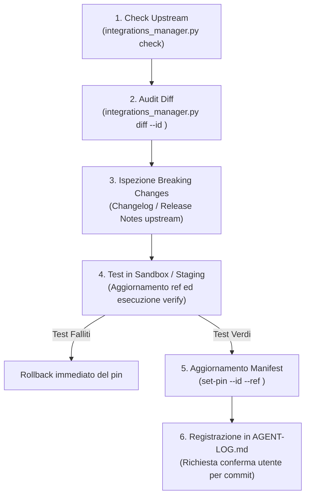

# Sistema di Gestione e Aggiornamento Integrazioni HyperSpace

Questo documento definisce il protocollo e gli strumenti operativi per tracciare, verificare e aggiornare in modo controllato tutti i componenti, repository esterni e progetti satellite integrati nell'ecosistema HyperSpace.

---

## 1. Topologia delle Integrazioni

In HyperSpace convivono quattro categorie di integrazioni:

| Categoria | Descrizione | Posizione tipica | Esempi |
|---|---|---|---|
| **`vendored`** | Codice importato e personalizzato all'interno del repository HyperSpace. | `integrations/<modulo>/` | `tiktok_editor/app`, `chrome-extension`, `telegram-worker` |
| **`external_node`** | Nodi custom o estensioni clonate/linkate a runtime negli ambienti di inferenza. | `${COMFYUI_CUSTOM_NODES}/...` | `ComfyUI_IPAdapter_plus`, `comfyui_controlnet_aux`, `ComfyUI-GGUF` |
| **`external_tool`** | Tool di training, OSINT o crawling con propri ambienti dedicati. | `data/training/tools/`, root esterna | `sd-scripts` (Kohya), `sherlock` |
| **`mesh_sibling`** | Repository git satellite presenti sulla stessa macchina / cluster. | `/Users/opo/<repo>` | `hyperswarm`, `minimesh`, `anna-mac`, `pole-motion-engine` |

---

## 2. Il Single Source of Truth: `integrations.manifest.yaml`

Tutte le integrazioni sono formalmente registrate in [`integrations/integrations.manifest.yaml`](file:///Users/opo/hyperspace-agi-1.04/integrations/integrations.manifest.yaml).

Ciascuna voce dichiara:
- `name`: Nome leggibile del componente.
- `category`: Tipologia (`vendored`, `external_node`, `external_tool`, `mesh_sibling`).
- `local_path`: Percorso locale (con supporto per espansione `~` e variabili d'ambiente bash `${VAR:-default}`).
- `upstream_url`: URL git remoto ufficiale (HTTPS o SSH).
- `pinned_ref`: Commit SHA esatto o tag validato contro cui gira HyperSpace.
- `pin_reason`: Spiegazione tecnica del perché è bloccato a quella versione (se applicabile).
- `active_branch`: Ramo primario di sviluppo upstream (`main`, `master`).
- `test_command`: Comando di non-regressione per verificare che il modulo funzioni.
- `reference_path`: Per i moduli vendorati, la cartella sorgente/storica di riferimento.

---

## 3. Strumenti Operativi

### A. CLI Principale: `scripts/integrations_manager.py`

Il tool centrale per agenti e sviluppatori. Opera in modalità **read-only di default** per prevenire modifiche accidentali.

```bash
# 1. Elenco di tutte le integrazioni registrate
.venv/bin/python scripts/integrations_manager.py list

# 2. Stato locale dei moduli (presenza su disco, commit attivo, stato git dirty)
.venv/bin/python scripts/integrations_manager.py status

# 3. Controllo upstream remoto (interrogazione non-invasiva via git ls-remote)
.venv/bin/python scripts/integrations_manager.py check

# 4. Audit delle differenze rispetto all'upstream o alla reference originale
.venv/bin/python scripts/integrations_manager.py diff --id tiktok_editor
.venv/bin/python scripts/integrations_manager.py diff --id hyperswarm

# 5. Esecuzione dei test di non-regressione per un modulo o per tutti
.venv/bin/python scripts/integrations_manager.py verify --id comfyui_ipadapter_plus
.venv/bin/python scripts/integrations_manager.py verify

# 6. Aggiornamento controllato del commit/tag nel manifest
.venv/bin/python scripts/integrations_manager.py set-pin --id kohya_sd_scripts --ref "v0.12.1"
```

### B. Diagnostica Automatica: `scripts/diagnostics/audit_integrations.py`

Esegue un health check completo su tutti i componenti con verifica upstream e test di non-regressione, salvando il report JSON consolidato:

```bash
.venv/bin/python scripts/diagnostics/audit_integrations.py --verify-all
```
Il report viene generato in `data/reports/integrations_audit.json`.

### C. Telemetria e Dashboard Cockpit

Il servizio `scripts/cockpit_service.py` espone l'endpoint real-time:
- **`GET http://localhost:8090/api/integrations`**
Fornisce in formato JSON lo stato istantaneo, il confronto commit vs upstream e i risultati dei test diagnostici per la dashboard Operations Cockpit.

---

## 4. Motore di Auto-Sync Continuo (`scripts/upstream_auto_sync.py`)

Per i repository esterni, skill e pacchetti che ricevono aggiornamenti frequenti (es. **REA**, **Agency Agents**, **AnyDoc**, **Wayfinder**, **ECC**):

```bash
# Esecuzione in modalità dry-run / ispezione
.venv/bin/python scripts/upstream_auto_sync.py

# Applicazione controllata con test non-regressivo e rollback automatico
.venv/bin/python scripts/upstream_auto_sync.py --apply

# Sincronizzazione di un singolo componente
.venv/bin/python scripts/upstream_auto_sync.py --component rea --apply
.venv/bin/python scripts/upstream_auto_sync.py --component agency --apply
```

### Self-Healing Guardrails
1. **Pre-aggiornamento:** verifica l'hash/versione locale e scarica i file aggiornati dall'upstream ufficiale.
2. **Test di validazione immediata:** esegue la suite specifica (`test_rea_surface.py`, `test_forge_skills.py`, `test_wayfinder.py`, `test_hermes_memory.py`).
3. **Rollback istantaneo:** se anche solo un test fallisce, l'aggiornamento viene revocato all'istante, ripristinando il manifest precedente e i file pregressi.
4. **Audit Log:** ogni operazione completata viene appesa a `data/reports/auto_sync_history.jsonl` e riassunta in `data/reports/auto_sync_status.json`.

### Esecuzione Automatica con LaunchAgent
È disponibile il file plist [`integrations/com.hyperspace.upstream-auto-sync.plist`](file:///Users/opo/hyperspace-agi-1.04/integrations/com.hyperspace.upstream-auto-sync.plist) per eseguire il controllo periodico automatico ogni 6 ore (21600s) o tramite cron.

---

## 5. Workflow per l'Aggiornamento di un Modulo

Quando una repo integrata ha aggiornamenti disponibili (`NEW_UPSTREAM_AVAILABLE`):



1. **Audit delle modifiche locali:** Prima di effettuare il pull o l'aggiornamento, usare `diff --id <modulo>` per verificare se HyperSpace ha aggiunto file custom o modificato comportamenti standard.
2. **Aggiornamento isolato:**
   - Per un nodo esterno (`external_node` o `external_tool`), spostarsi nel path locale ed eseguire checkout del nuovo tag o commit validato.
   - Per un componente vendorato, applicare selettivamente le modifiche preservando i file con personalizzazioni HyperSpace (es. preset, pipeline, swift bridges).
3. **Verifica Non-Regressione:** Lanciare `.venv/bin/python scripts/integrations_manager.py verify --id <modulo>`.
4. **Fissaggio nel Manifest:** Se i test passano, aggiornare il pin con `.venv/bin/python scripts/integrations_manager.py set-pin --id <modulo> --ref <nuovo_commit>`.
5. **Nessun push/commit senza autorizzazione:** Documentare l'avvenuto passaggio in `AGENT-LOG.md` nel rispetto delle regole generali del progetto.
