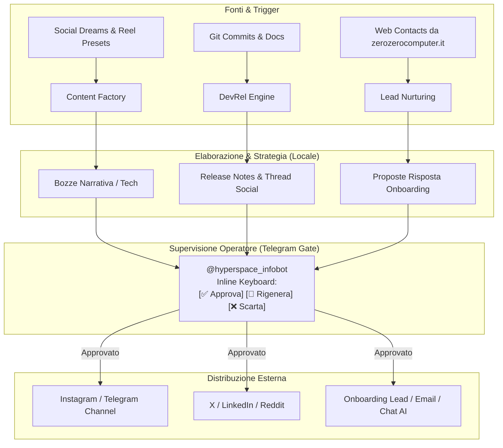

# HyperSpace Marketing & Adoption Engine

Motore unificato per la gestione autonoma del marketing, della narrazione e dell'adozione tecnologica di HyperSpace, integrato con il runtime locale e supervisionato dall'operatore via Telegram.

---

## 1. Architettura e Pilastri

Il sistema risponde alle tre esigenze fondamentali del progetto, coordinando i componenti già operativi nel repository:



### I Tre Pilastri:

1. **Content Factory (Narrativa & Tech)**:
   * **Linea Creativa (Aurora & Anna)**: Genera i post del "Sogno di stanotte", poesie e concept reel visivi coerenti con l'identità del progetto narrativo (`docs/growth-strategy.md` e `docs/social.md`).
   * **Linea Tecnica (Framework HyperSpace)**: Genera pillole di architettura (mesh P2P crittografata, quantizzazione ternaria Bonsai 2 su RTX 3070, grafo di memoria Hermes).

2. **Lead Nurturing & Onboarding Automatico**:
   * Monitora i contatti acquisiti dal form di `zerozerocomputer.it` registrati in SQLite (`web_contacts`).
   * Classifica l'intento dell'utente (`dev_mesh`, `access_key`, `partnership_project`, `general_curiosity`).
   * Prepara una risposta personalizzata che include il benvenuto, il link diretto alla chat con la chiave membro associata (`hs-mesh-*`) e suggerimenti su prompt da testare.

3. **DevRel & Tech Storytelling**:
   * Estrae i commit Git e le novità documentali.
   * Genera in automatico:
     - **GitHub Release Notes & Discussions** in Markdown strutturato.
     - **Thread per X / LinkedIn / Mastodon** (3-5 post concisi con hook e call to action).
     - **Post di approfondimento per Reddit** (`r/LocalLLaMA`, `r/AI_Agents`).

---

## 2. Il Telegram Gate (Human-In-The-Loop)

Per garantire la massima sicurezza e coerenza editoriale, **nessun contenuto viene pubblicato all'esterno senza la conferma esplicita dell'operatore**.

* Ogni bozza viene inviata alla chat Telegram configurata con pulsanti inline:
  * `[✅ Approva & Pubblica]`: convalida la bozza e ne sblocca la pubblicazione;
  * `[🔄 Rigenera]`: scarta la bozza corrente e ne produce una nuova con una diversa angolatura;
  * `[❌ Scarta]`: archivia la proposta.
* In assenza di token Telegram configurati, il sistema opera in modalità **Dry-Run sicura** salvando le bozze su disco per l'ispezione via terminale.

---

## 3. Guida ai Comandi CLI

L'interfaccia principale è il comando `scripts/marketing/engine.py`.

### Controllo Stato e KPI
```bash
.venv/bin/python scripts/marketing/engine.py status
```
Mostra la dashboard con il conteggio delle bozze (in bozza, in approvazione, approvate, rifiutate) e dei contatti web elaborati.

### Generazione Bozze di Contenuto
```bash
# Genera sia una bozza creativa che una tecnica
.venv/bin/python scripts/marketing/engine.py draft

# Genera solo una bozza per Aurora o Anna
.venv/bin/python scripts/marketing/engine.py draft --track creative --author Anna

# Genera e invia subito la richiesta di revisione su Telegram
.venv/bin/python scripts/marketing/engine.py draft --notify
```

### Elaborazione Lead e Nuovi Utenti
```bash
# Analizza i contatti web pendenti e genera le risposte di accoglienza
.venv/bin/python scripts/marketing/engine.py leads

# Elabora e notifica l'operatore su Telegram per ciascun nuovo lead
.venv/bin/python scripts/marketing/engine.py leads --notify
```

### Generazione Changelog & Thread DevRel
```bash
# Genera tutti i formati (GitHub Release, Social Thread, Reddit Post)
.venv/bin/python scripts/marketing/engine.py changelog

# Genera solo il thread pronto per X / Mastodon
.venv/bin/python scripts/marketing/engine.py changelog --format thread

# Genera il post per r/LocalLLaMA specificando la versione
.venv/bin/python scripts/marketing/engine.py changelog --format reddit --version 1.05.5
```

### Ciclo Completo Giornaliero
```bash
# Esegue in sequenza: bozza narrativa + bozza tecnica + scansione lead + invio review
.venv/bin/python scripts/marketing/engine.py run-daily
```

---

## 4. Variabili d'Ambiente

Le variabili possono essere impostate nell'ambiente o in `data/telegram-bot.env`:

| Variabile | Descrizione |
|---|---|
| `TELEGRAM_MARKETING_BOT_TOKEN` | Token del bot Telegram per la gestione marketing (fallback a `CONTACT_TELEGRAM_BOT_TOKEN` o `TELEGRAM_BOT_TOKEN`). |
| `TELEGRAM_MARKETING_CHAT_ID` | Chat ID dell'operatore che riceve le bozze e i bottoni di approvazione. |
| `INSTAGRAM_DREAM_PUBLISH_ENABLED` | Se `true`, abilita l'invio automatico a Instagram delle voci approvate. |
| `INSTAGRAM_PUBLIC_BASE_URL` | Base URL pubblico (es. `https://media.zerozerocomputer.it`) per gli asset grafici. |

---

## 5. File Dati e Persistenza

Tutti i dati generati risiedono nella cartella `data/marketing/` (esclusa o tracciata localmente):
* `data/marketing/drafts.json`: Archivio delle bozze create, stato e canali target.
* `data/marketing/leads_state.json`: Registro degli stati di accoglienza dei contatti web.
