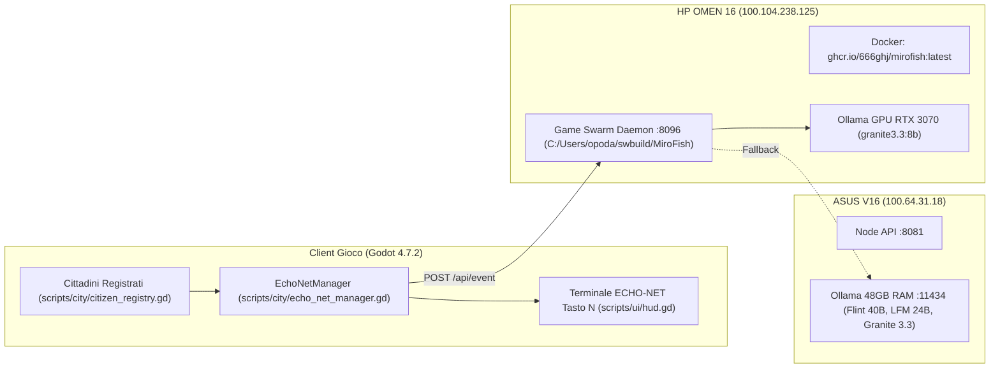

# Integrazione MiroFish & OASIS per la Simulazione della Città Cyberpunk

Questo documento descrive l'integrazione di **MiroFish** (`666ghj/MiroFish`) e del framework **OASIS** (CAMEL-AI) all'interno del progetto **Syndicate-Godot** e dell'infrastruttura nodale HyperSpace.

---

## 1. Obiettivo dell'Architettura

Trasformare i cittadini della metropoli da semplici pedoni geometrici a uno **sciame sociale autonomo e reattivo** (*Swarm Intelligence*), in grado di:
1. Condividere opinioni, dicerie e meme su una rete sociale interna (**ECHO-NET**).
2. Modificare in tempo reale il morale e l'opinione pubblica cittadina (*Corp Fear*, *Syndicate Approval*, *Police Alert*, *Anarchy Index*).
3. Ascoltare bollettini radiofonici pirata (**Radio Free Herzog 107.7 FM**) e comunicati di regime corporativo (**W-Corp News**).
4. Reagire dinamicamente agli eventi causati dalla squadra del giocatore (collasso grattacieli con granate atomiche, mazzette ai funzionari, furti di brevetti).

---

## 2. Topologia dei Nodi (OMEN & ASUS)



- **HP OMEN 16 (`100.104.238.125`)**:
  - Clonato il repo `MiroFish` in `C:\Users\opoda\swbuild\MiroFish`.
  - Container Docker ufficiale attivo: Web UI esplorabile su **`http://100.104.238.125:3000`** e backend MiroFish su porta **5001**.
  - Servizio attivo sulla porta **8096**: demone Python REST `game_swarm_daemon.py` per Godot.
  - Ingestione eventi in real-time e generazione di post/bollettini tramite `granite3.3:8b` accelerato su NVIDIA RTX 3070.
- **ASUS V16 (`100.64.31.18`)**:
  - Pool di memoria estesa (48 GB RAM) con Ollama attivo sulla porta **11434** per inferenze complesse o fallback.

---

## 3. Specifiche API del Demone di Sciame (`game_swarm_daemon.py`)

### `GET /health`
Verifica lo stato del demone e restituisce i livelli attuali di opinione pubblica.
```json
{
  "status": "ok",
  "service": "MiroFish OASIS Swarm Game Simulator",
  "port": 8096,
  "sentiment": {
    "corp_fear": 35.0,
    "syndicate_approval": 48.0,
    "police_alert": 20.0,
    "anarchy_index": 25.0
  },
  "feed_size": 12
}
```

### `POST /api/event`
Invia un evento di gioco dallo scenario di Godot allo sciame.
- **Payload**:
```json
{
  "event_type": "nuke_collapse",
  "description": "Detonazione atomica e crollo della Torre OMEN a Herzog Plaza"
}
```
- **Risposta**:
```json
{
  "success": true,
  "post": {
    "id": "SWARM-1794229882",
    "author_name": "Kira_NetRunner",
    "author_role": "PUNK",
    "content": "Avete sentito il botto? La città non dorme mai quando il sindacato entra in azione. #nuke_collapse",
    "likes": 129,
    "reposts": 35,
    "timestamp": "14:11:22"
  },
  "bulletin": "ALLERTA METROPOLITANA // NUKE_COLLAPSE: Detonazione atomica e crollo della Torre OMEN a Herzog Plaza",
  "sentiment": {
    "anarchy_index": 45.0,
    "corp_fear": 65.0,
    "police_alert": 55.0,
    "syndicate_approval": 63.0
  }
}
```

---

## 4. Controlli & Tasti Rapidi in Godot

- **`N`**: Apre o chiude il **Terminale ECHO-NET** (mostra feed social, bollettini radio, breaking news e indici di sentimento).
- **`C`**: Apre il dossier anagrafico del cittadino cliccato o selezionato.
- **`P`**: Apre la finestra del Senato Metropolitano e Tangenti.
- **`R`**: Apre la matrice di Ricerca Scientifica e Fabbricazione nodale.
- **`B`**: Apre la schermata Finanze & Armeria.
