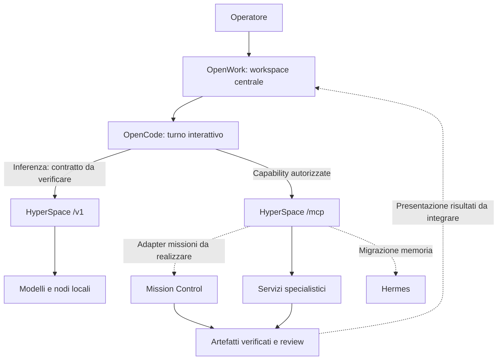

# OpenWork come workspace centrale di HyperSpace

Data: 2026-10-09. Direzione richiesta dall'utente: fare di OpenWork il centro
dell'esperienza di lavoro HyperSpace. Stato: progettazione dell'integrazione;
nessuna installazione o prova end-to-end OpenWork è stata eseguita qui.

## Risultato di prodotto

L'utente apre un progetto, assegna un obiettivo e segue il lavoro fino a un
artefatto utilizzabile nello stesso ambiente. OpenWork diventa il workspace
principale; HyperSpace gli fornisce inferenza, memoria e capacità operative.
Le superfici specialistiche restano accessibili per editing e diagnostica.

OpenWork dichiara un'app desktop basata su OpenCode, lavoro sui file locali,
skill e MCP. Il core corrente usa React/Electron e comprende un server;
le funzionalità organizzative sono raccolte in OpenWork Den.
[Fonte: repository, branch dev](https://github.com/different-ai/openwork).

La scelta utile per noi è unificare il percorso richiesta → lavoro → risultato.
Non basta aggiungere una card che apre un altro programma. La proposta prende
anche spunto dai principi di OpenWork: stato osservabile, dettagli tecnici
accessibili su richiesta, errori con un'azione di recupero e artefatti visibili.
[Fonte: DESIGN.md](https://github.com/different-ai/openwork/blob/dev/DESIGN.md).

## Responsabilità proposte

| Componente | Responsabilità nell'integrazione |
|---|---|
| OpenWork | Workspace principale, conversazione, file, avanzamento e risultati |
| OpenCode | Esecuzione del turno interattivo e chiamata dei tool offerti al client |
| HyperSpace Control Plane | Routing dell'inferenza, risorse, autorizzazione delle proprie capability, audit |
| Mission Control | Missioni delegate durevoli, DAG, budget, verifica e review |
| Tool & Skill Forge | Validazione e approvazione delle capacità pubblicate al workspace |
| Hermes | Direzione del backend di memoria condivisa; migrazione ancora incompleta |
| ComfyUI, ufficio, reel, comic, REA, Graphify | Servizi specialistici richiamati tramite contratti espliciti |

Un task ha un solo proprietario dell'esecuzione. Se OpenCode delega una missione,
riceve l'ID e ne consulta lo stato; non rilancia in parallelo gli stessi passi.
Il successo deve dipendere dal risultato verificato, non dalla risposta della
chat. Le autorizzazioni del client devono essere coerenti con quelle server:
un permesso MCP non governa automaticamente shell o filesystem di OpenCode.

## Punti di collegamento già presenti e problemi da chiudere

OpenWork documenta provider personalizzati tramite `opencode.jsonc` e API
Chat Completions, senza richiedere un account cloud per il provider locale.
[Fonte: custom LLM](https://openworklabs.com/docs/start-here/connect-your-stack/add-a-custom-llm).
I server MCP del workspace possono essere locali/personalizzati.
[Fonte: custom MCP](https://openworklabs.com/docs/start-here/connect-your-stack/add-an-mcp-server).

Nel repository abbiamo `/v1/chat/completions` e `/mcp`, ma questo non prova la
compatibilità con OpenWork. Dal codice esaminato emergono questi lavori:

1. **Inferenza senza doppio loop.** `control-plane/cp/chat.py` aggiunge il catalogo
   nativo e gestisce internamente le sue chiamate. Il passthrough esistente
   restituisce al client i tool esterni, ma `X-Hyperspace-Tools: off` in
   `_run_tool_loop` rimuove anche i tool del client. Occorre una modalità
   distinta che conservi schema, ID e chiamate del client, evitando iniezione
   ed esecuzione dei tool interni. Verificare stream, non-stream e fallback.
   Nel ramo stream il catalogo viene inoltre ricomposto: tutti i percorsi
   devono rispettare lo stesso contratto. Il flag esistente deve conservare
   la semantica usata dagli altri client.
2. **MCP reale.** `control-plane/cp/tool.py` offre initialize, notifications,
   ping e tools/list/call via POST. Provare il trasporto con il client OpenCode
   della release scelta: un test JSON-RPC isolato non basta. Usare un client
   `openwork` e un'allowlist server dedicata, inizialmente di sola lettura.
   OpenCode documenta header Bearer con variabili d'ambiente e `oauth: false`;
   questo coincide con il nostro schema di autenticazione, da provare dal vivo.
   [Fonte: MCP OpenCode](https://opencode.ai/docs/mcp-servers/).
3. **Missioni.** Il catalogo in `cp/tools_defs.py` non pubblica le operazioni
   `/missions`. Serve un adapter esplicito per creazione, stato, annullamento
   e artefatti, rispettando i permessi operatore. Definire un identificatore
   di richiesta idempotente prima di permettere retry della creazione.
4. **Skill.** Pubblicare solo skill Forge approvate, con versione e provenienza.
   La selezione del workspace e gli hook HyperSpace devono evitare duplicati
   nello stesso contesto. Verificare discovery, aggiornamento e revoca.
5. **Artefatti e memoria.** Definire accesso ai file remoti, manifest con tipo,
   percorso/URL, digest ed esito della verifica. La cronologia di una chat
   non sostituisce il backend Hermes; la memoria condivisa passa dal relativo
   adapter HyperSpace quando disponibile.

Il catalogo dei modelli e i fallback restano soggetti alla policy di VISION.md.
La disponibilità di un provider nell'interfaccia non ne costituisce l'abilitazione
per HyperSpace. Per il pilot usare un workspace dedicato e controllare quali
azioni locali OpenCode può eseguire oltre ai tool MCP.

### Riscontro del primo pilot locale (2026-10-09)

La prima conversazione OpenWork è entrata in un ciclo di compattazione:
`This conversation is too long for the model` e ripetizione del riepilogo
senza chiamare `apple_intelligence_status`. Non era un fallimento del tool Apple:
la chiamata non è mai partita. Il modello Ollama attivo
`qwen3-8b-abliterated-g8k:latest` aveva `num_ctx=8192`. Media allegati avevano
anche superato il limite del provider; riavviare quella stessa conversazione
mantiene un contesto già saturo.

Per la prova breve è stato creato l'alias Ollama
`hyperspace-openwork:32k` a partire da un modello 8B già presente, con
`num_ctx=32768` e senza scaricare nuovi pesi. `data/openwork-apple-pilot/opencode.json`
lo seleziona e abilita compattazione/pruning. L'inferenza locale ha risposto e
`/api/ps` ha confermato 32768 token effettivi; la sessione OpenWork con MCP
deve ancora essere verificata in una **nuova conversazione**.

Questo corregge il limite immediato del pilot, non dimostra sviluppo autonomo
lungo: la guida Ollama per OpenCode raccomanda almeno 64K per attività agentiche
e coding. Con 16 GiB sul Mac e altri carichi attivi, prima di aumentare ancora
il contesto occorre misurare memoria e offload. I checkpoint durevoli e il gate
di completamento restano responsabilità di Mission Control.
[Fonti: guida Ollama per OpenCode](https://docs.ollama.com/integrations/opencode),
[contesto Ollama](https://docs.ollama.com/context-length).

OpenWork supporta turni interattivi che compiono più passi, ma la sua roadmap
elenca workspace cloud sempre attivi e background task tra le funzioni in
sviluppo. OpenDots di CopilotKit è un template iniziale con job pianificati,
pausa/retry e computer per agenti; dichiara che gli schedule non formano un
motore di obiettivi completi. È un candidato da confrontare su un pilot, non
una cura automatica del problema di contesto: dipende anch'esso dal modello
configurato. [Fonti: roadmap OpenWork](https://openworklabs.com/docs/roadmap),
[README OpenDots](https://github.com/CopilotKit/OpenDots).

## Adozione per prove complete

1. **Collegamento minimo:** scegliere e fissare una release/tag con commit e
   licenza verificati; risolvere il contratto di inferenza; collegare un modello
   locale e il client MCP ristretto. Accettazione: una chiamata client eseguita
   una sola volta, un tool vietato respinto e un errore di backend visibile,
   sia in streaming sia senza streaming.
2. **Presentazione PDF:** dalla conversazione OpenWork delegare a Mission Control
   la raccolta dei documenti HyperSpace e la produzione della presentazione.
   Mostrare stato, fonti e PDF finale. Accettazione: tre run con PDF apribile,
   pagine e testo verificati, fonti consultabili, senza dichiarare riuscita una
   run che non ha prodotto il file. La qualità editoriale richiede anche review
   visiva umana. Provare annullamento, riavvio e recupero senza doppio lavoro.
3. **Workspace principale:** dopo queste prove rendere OpenWork il punto di
   ingresso quotidiano, collegare strumenti creativi e memoria e relegare la
   dashboard tecnica alla gestione operativa. Misurare completamento reale,
   latenza, costo e interventi manuali rispetto al flusso attuale.

Il rollback del pilot consiste nel disabilitare il suo client MCP e rimuovere
la configurazione del workspace dedicato. Migrazione di dati e avvio automatico
vengono dopo le prove, con procedure proprie.

## Licenza e manutenzione

Il LICENSE consultato su `dev` distingue il core MIT dal contenuto `ee/` sotto
OpenWork EE License e mantiene le licenze dei componenti di terze parti.
Le versioni precedenti possono avere condizioni differenti. L'adozione iniziale
proposta usa il core locale e il control plane HyperSpace; le funzioni Den
richiedono una valutazione separata della versione e delle condizioni applicabili.
[Fonti: LICENSE](https://github.com/different-ai/openwork/blob/dev/LICENSE),
[mappa REUSE](https://github.com/different-ai/openwork/blob/dev/REUSE.toml).

I riferimenti `dev` di questa analisi sono mobili. Prima di importare codice o
distribuire un'app occorre fissare il commit e registrarne le attribuzioni.
Preferire inizialmente configurazione e adapter piccoli: un fork dell'intera UI
va motivato da un requisito che le interfacce pubbliche non soddisfano.

## Consegna condivisa

Primo lavoro: modalità di inferenza per runtime esterno con regressioni su
tool client e streaming, poi prova MCP con OpenCode reale. Lavoro successivo:
adapter Mission Control e percorso PDF. Coordinarsi in AGENT-LOG.md prima di
toccare `cp/chat.py`, `cp/tool.py`, dashboard o bootstrap condivisi.

Questa nota definisce la direzione e i criteri di accettazione; non dichiara
già disponibili integrazione, installazione, adapter o nuove garanzie operative.
