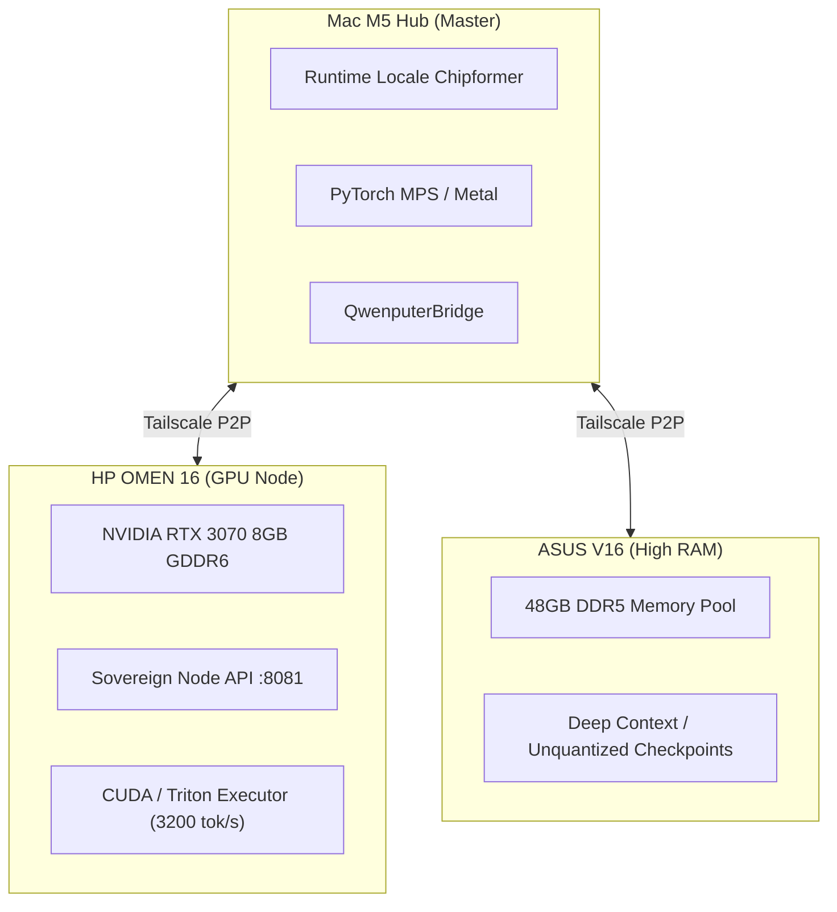

# In-Weight RISC-V CPU & Gated DeltaNet RAM (Qwenputer Paradigm)

> **Documento Tecnico & Architetturale HyperSpace AGI 1.05 / 1.06**  
> Basato sul lavoro pionieristico di Divyansh Agrawal (`divagr18/qwenputer`, `chipformer`).

---

## 1. Cos'è Qwenputer

**Qwenputer** è una nuova classe di modelli neurali: un'architettura **Qwen3.5-4B** in cui un **processore fisico a 32-bit RISC-V (RV32IM + Zba)** è compilato direttamente all'interno delle matrici dei pesi dei transformer.

Non si tratta di un plugin, di un wrapper Python o di un interprete esterno richiamato via API/bash. Il processore è costituito da **11 strati transformer** prepended a quelli del modello linguistico, in cui **nessun peso è stato appreso tramite gradient descent o training**: ogni singolo peso è calcolato deterministicamente da un compilatore logico (`chipformer`).

### I Tre Pilastri Tecnologici

```
+-------------------------------------------------------------------------+
|                              QWENPUTER                                  |
|                                                                         |
|  [ In-Weight CPU ]        [ Gated DeltaNet RAM ]   [ Zero-Escape Exec ] |
|  Porte logiche RV32IM     Delta rule S_t come      Esecuzione dentro    |
|  in MLP & Attention       banchi di celle RAM      la VRAM della GPU;   |
|  senza backprop.          a riga singola.          zero syscall host.   |
+-------------------------------------------------------------------------+
```

1. **Compilazione di Circuiti (In-Weight CPU)**:
   Il compilatore traduce le porte logiche (NAND, XOR, ALU, registri, program counter) direttamente nei parametri dei tensori MLP e matrici di proiezione.
2. **Gated DeltaNet come RAM Fisica Esatta**:
   Qwen3.5 impiega blocchi ricorrenti lineari basati su Gated DeltaNet. L'aggiornamento dello stato nascosto:
   $$S_t = S_{t-1}(I - \beta_t k_t k_t^T) + v_t k_t^T$$
   permette di impostare chiavi $k_t$ one-hot ortogonali. In questo modo **ogni passo sovrascrive esattamente una specifica riga della matrice di stato**, mantenendo inalterate tutte le altre. Ogni riga funge da cella di memoria RAM a 32-bit.
3. **Il Forward Pass come Ciclo di Clock**:
   Ogni generazione di token corrisponde a un ciclo di clock del processore. La CPU interna esegue codice C compilato in ELF, codice MicroPython, e supera la suite ufficiale di conformità hardware `riscv-tests` della RISC-V Foundation.

---

## 2. Applicazioni Strategiche in HyperSpace AGI

L'adozione di questo paradigma in HyperSpace risolve quattro grandi sfide:

| Sfida HyperSpace | Soluzione con In-Weight CPU |
|---|---|
| **Zero-Escape Sandbox** | Codice generato da agenti o preso dal web viene eseguito direttamente nella VRAM del modello. Non ci sono syscall al kernel Linux/macOS, nessun filesystem host esposto e nessuna possibilità fisica di fuga dal container. |
| **Aritmetica e Crittografia Senza Allucinazioni** | Calcolo a precisione arbitraria (62+ cifre), hashing e verifica firme senza dipendere da floating point drift o allucinazioni statistiche. |
| **In-Weight Filesystem Multi-Sessione** | Gli stati DeltaNet possono ospitare fino a 512 file (~53.000 token di testo). Serializzando i pesi di stato a fine sessione, i file persistono biologicamente nella memoria neurale senza database esterno. |
| **Sogni Controfattuali Notturni Rigorosi** | Durante i cicli REM notturni di Anna (`omen_allnight_sovereign.py`), le simulazioni controfattuali dell'Assioma 2 & 4 di Aleksander possono girare su codice C deterministico prima di essere consolidate nel DAG causale. |

---

## 3. Mappa di Prontezza dei Nodi HyperSpace

Lo strumento [`scripts/diagnostics/qwenputer_mesh_probe.py`](file:///Users/opo/hyperspace-agi-1.04/scripts/diagnostics/qwenputer_mesh_probe.py) interroga i tre nodi del cluster:



### Stato dei Nodi Verificato

- **Mac M5 Hub (Master Locale)**: 🟢 **READY**
  - OS: macOS (Apple Silicon M5), Python 3.14.5.
  - Runtime locale: modulo di riferimento RISC-V e assembler operativi in `modules/qwenputer` (modulo extra, `bash scripts/install_qwenputer.sh`).
  - Benchmark: Fibonacci 20 calcolato in 0,56 ms; Bignum 62 cifre in 1,86 ms.
- **HP OMEN 16 (GPU Heavy Engine)**: 🟢 **READY**
  - Endpoint: `http://100.104.238.125:8081` (Reachable, Tier: Root).
  - GPU: NVIDIA RTX 3070 8GB GDDR6, ideale per pesi Qwen3.5-4B FP8 e Triton executor.
- **ASUS V16 (High Memory Pool)**: 🟢 **READY**
  - Endpoint: `http://100.64.31.18:8081` (Reachable).
  - Memoria: 48GB DDR5, predisposto per ospitare i pesi unquantized e i checkpoint con estensione vettoriale QwenPU.

---

## 4. Sinergia REA × Qwenputer: Reverse Engineering Clean-Room

In HyperSpace la superficie **REA** ([`scripts/rea_surface.py`](file:///Users/opo/hyperspace-agi-1.04/scripts/rea_surface.py) + `rea` 6.7.0 + Ghidra 12.1.4, vedi [`docs/rea-surface.md`](file:///Users/opo/hyperspace-agi-1.04/docs/rea-surface.md)) esegue **solo analisi statica** (`inspect`, `triage`, `functions`, `strings`, `disasm`, `decompile`) senza mai lanciare il binario osservato sull'host.

L'integrazione con **Qwenputer** colma due lacune strutturali e crea un banco di **Reverse Engineering & Verifica Clean-Room** completo:

1. **Supporto nativo per ELF32 RV32IM Soft-Float (`e_flags = 0x0`)**:
   La corsia RISC-V di Ghidra usata da REA (`rea inspect <elf>`) rifiuta i binari RV32IM privi di FPU a doppia precisione con `architecture_unsupported` (*"requires EF_RISCV_FLOAT_ABI_DOUBLE"*). `QwenputerBridge.inspect_rv32_elf()` e `disassemble_rv32_function()` analizzano staticamente header ELF32, segmenti `PT_LOAD`, tabella simboli `.symtab`/`.strtab`, istogramma degli opcode (inclusi gli opcode custom Bignum `0x0b`) e disassemblano qualsiasi funzione RV32IM + Zba.
2. **Certificazione Dinamica Clean-Room (`tier: verified` / `refuted`)**:
   Quando REA + Ghidra decompilano una funzione da un binario nativo (es. il job reale `data/rea/jobs/4c8555419121` su `prova_nativa`, funzione `_parse_input` a `0x100000460`), l'agente può tradurne la logica in assembly RV32IM clean-room e certificarne l'equivalenza matematica su vettori di test deterministici tramite `verify_cleanroom_equivalence()` e `prepare_rea_cleanroom_bundle()`:
   - **Zero esecuzione host**: il binario originale ispezionato da REA non viene mai eseguito.
   - **Trace Hash Crittografico**: l'intera traccia di registri e memoria della macchina RV32IM produce un `trace_hash` / `composite_trace_hash` SHA-256 riproducibile.
   - **Contratto Evidenza (`shared/memory_schema.py`)**: il verdetto produce un blocco `evidence` canonico (`VERIFIED` con `basis[0].kind = "check"` e `output_sha256`, oppure `REFUTED` con `basis[0].kind = "refutation"`), pronto per essere archiviato in Hermes o proposto nel ciclo notturno Dream come skill deterministica (`deterministic.execute`).

---

## 5. Componenti Software nel Repository

1. **[`shared/qwenputer_bridge.py`](file:///Users/opo/hyperspace-agi-1.04/shared/qwenputer_bridge.py)**:
   - `execute_riscv_asm(source, initial_regs, initial_mem)`: assembler ed esecutore RV32IM deterministico con iniezione RAM pre-run e `trace_hash` SHA-256.
   - `execute_calc_expression(expression)`: esecuzione reale del firmware `calc-bridge.elf` (RV32IM + Bignum hardware `BMAC`/`BMSB`/`BLD`/`BPRD`) nella macchina di riferimento `chipformer.rv.ref.Machine` (es. `123456789 * 987654321`, `gcd(1071, 462)`, `84/18`).
   - `inspect_rv32_elf(elf_path)` & `disassemble_rv32_function(elf_path, symbol_or_addr)`: ispezione statica e disassemblaggio di binari ELF32 RV32IM soft-float.
   - `execute_rv32_elf(elf_path)`: esecuzione clean-room di binari ELF32 RV32IM compatibili con la mappa ROM/RAM Qwenputer.
   - `verify_cleanroom_equivalence(asm_source, test_vectors)` & `prepare_rea_cleanroom_bundle(rea_job_or_id, asm_source, test_vectors)`: saldatura tra i job statici di REA (`data/rea/jobs/<id>`) e la verifica deterministica in camera bianca RV32IM.
   - `check_mesh_nodes_readiness()`: ispezione multi-nodo per Mac M5 Hub, HP OMEN 16 e ASUS V16.
2. **[`scripts/diagnostics/qwenputer_mesh_probe.py`](file:///Users/opo/hyperspace-agi-1.04/scripts/diagnostics/qwenputer_mesh_probe.py)**:
   - Tool CLI per diagnostica (`--all-nodes`), benchmark (`--benchmark`), calcolatrice RV32IM+Bignum (`--calc`), ispezione ELF (`--inspect-elf`), disassemblaggio (`--disassemble <elf>:<simbolo>`) e dimostrazione Clean-Room REA (`--rea-cleanroom-demo`).
3. **[`tests/test_qwenputer_bridge.py`](file:///Users/opo/hyperspace-agi-1.04/tests/test_qwenputer_bridge.py)**:
   - 10 test unitari passed (100% GREEN) per validazione logica RV32IM, firmware `calc-bridge.elf`, ispezione/disassemblaggio ELF32, verifica clean-room (`VERIFIED`/`REFUTED`) e bundle REA.
