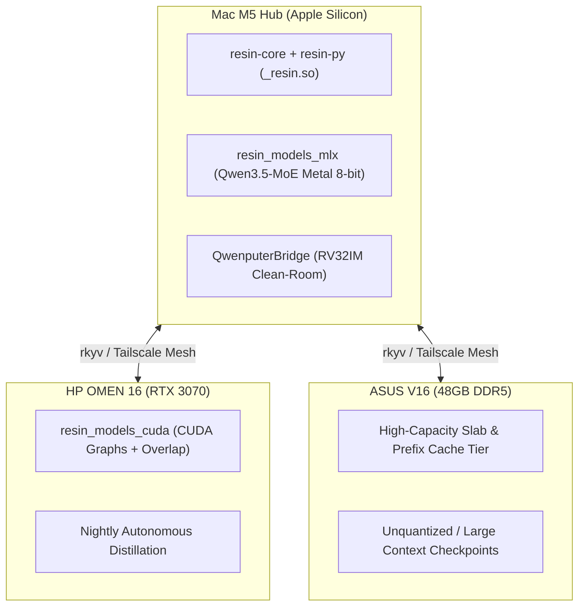

# Substrato d'Inferenza Rust Resin — Architettura HyperSpace 1.06

> **Documento Architetturale HyperSpace AGI 1.06**  
> Basato su `ekzhang/resin` (Eric Zhang, Apache-2.0, commit fissato `3f68b0a5024859e0f7cef8b7a348adb8c3293c5d`).

---

## 1. Perché Resin segna il passaggio a HyperSpace 1.06

Fino a HyperSpace 1.05, l'inferenza locale si è appoggiata a server monolitici (Ollama, vLLM, llama.cpp), dove lo scheduler delle richieste, la gestione della KV cache, il rendering dei template di conversazione e i kernel hardware vivono accoppiati in un unico processo.

**Resin** introduce una separazione strutturale netta tra **possesso delle risorse (Rust)** ed **esecuzione dei tensori (Runner hardware)**:

```
token IDs ──► Rust Engine (resin-core) ──► frozen BatchPlan (rkyv) ──► Runner (MLX / CUDA / Qwenputer) ──► token IDs
                    ▲                                                             │
                    └───────────── lease, prefix trie & STATE commit ─────────────┘
```

### I Quattro Crate Rust del Substrato (`modules/resin/crates/`)

| Crate | Ruolo in HyperSpace 1.06 |
|---|---|
| **`resin-core`** | Scheduler transazionale Rust (`EngineCore<P>`), admission control, chunked prefill, zero-overhead overlap e **Unified Paged Slab Cache** (`HISTORY` + `WINDOW` + `STATE`). Zero dipendenze da Python o PyTorch. |
| **`resin-recipe`** | Rendering nativo delle conversazioni e parser incrementale byte-accurate per tool calling e reasoning (`qwen`, `deepseek`, `gemma4`, `gpt_oss`, `lfm2`). |
| **`resin-http`** | Server HTTP ad alte prestazioni compatibile con OpenAI (`/v1/chat/completions`, `/v1/responses`), Anthropic (`/v1/messages`) ed export metriche Prometheus (`/metrics`). |
| **`resin-py`** | Binding PyO3 ABI3 (`resin._resin`) zero-copy che espone `Engine`, `BatchPlan`, `CacheLayout`, `ForwardOutput` e `SamplingParams` ai runner Python. |

---

## 2. Sinergia tra Resin e Qwenputer (Gated DeltaNet `STATE` + KV `HISTORY`)

Il vantaggio decisivo di Resin per HyperSpace 1.06 è la gestione nativa degli **stati ricorrenti** (`CacheGroupFamily.STATE`) nello stesso pool fisico di slab della KV cache d'attenzione (`CacheGroupFamily.HISTORY`):

1. **Slab Pool Fungibile**:
   Ogni `Engine` possiede un unico pool di slab fisici di uguale dimensione. Uno slab può ospitare $N$ blocchi di KV cache (`HISTORY`) oppure uno slot di stato ricorrente Gated DeltaNet (`STATE`).
2. **Snapshot Immutabili di Prefisso per DeltaNet & In-Weight RAM**:
   Quando `prefix_cache=True` è attivo, il block trie LRU di Resin allinea i confini dei blocchi tra attenzione e stato ricorrente. Quando una richiesta raggiunge un confine di blocco, `BatchPlan.cache_groups[i].state.checkpoint_slots` riserva uno slot di snapshot e il runner conferma la scrittura con `ForwardOutput.with_state_checkpoints(receipts)`.
3. **Zero Ricalcolo per Scami Multi-Agente**:
   Quando Anna, Aurora o gli agenti del turno di notte condividono il prompt di sistema o un "briefcase cognitivo" Qwenputer, le richieste successive ottengono un **prefix hit istantaneo** (`cached_tokens > 0`): Resin copia lo snapshot `STATE` DeltaNet nello slot live privato della nuova sequenza (`restore_copies`) senza ricalcolare il prefill.

---

## 3. Allocazione Multi-Nodo su HyperSpace 1.06



---

## 4. Installazione, Onboarding e Diagnostica

### Installazione del Modulo Extra `resin`

```bash
# macOS / Linux
bash scripts/install_resin.sh

# Windows PowerShell
powershell -ExecutionPolicy Bypass -File scripts\install-resin.ps1

# Onboarding nodo con il pacchetto Substrato 1.06 (resin + qwenputer)
.venv/bin/python scripts/node_onboarding.py --profile dev --package substrato
```

### Diagnostica e Simulazione Ibrida (`HISTORY` + `STATE`)

Lo script [`scripts/diagnostics/resin_mesh_probe.py`](file:///Users/opo/hyperspace-agi-1.04/scripts/diagnostics/resin_mesh_probe.py) verifica il binding Rust, lo stato dei 3 nodi e certifica un ciclo completo dello scheduler con prefix reuse e snapshot `STATE`:

```bash
.venv/bin/python scripts/diagnostics/resin_mesh_probe.py --all-nodes --simulate-hybrid
```

### Componenti nel Repository

- **[`shared/resin_bridge.py`](file:///Users/opo/hyperspace-agi-1.04/shared/resin_bridge.py)**: `ResinBridge` con `get_substrate_info()`, `simulate_hybrid_slab_schedule()` (con certificazione `tier: verified` su [`validate_evidence()`](file:///Users/opo/hyperspace-agi-1.04/shared/memory_schema.py#L140-L214)) e `check_mesh_nodes_readiness()`.
- **[`scripts/install_resin.sh`](file:///Users/opo/hyperspace-agi-1.04/scripts/install_resin.sh)** & **[`scripts/install-resin.ps1`](file:///Users/opo/hyperspace-agi-1.04/scripts/install-resin.ps1)**: installer riproducibili su commit fissato `3f68b0a5024859e0f7cef8b7a348adb8c3293c5d`.
- **[`scripts/diagnostics/resin_mesh_probe.py`](file:///Users/opo/hyperspace-agi-1.04/scripts/diagnostics/resin_mesh_probe.py)**: probe CLI multi-nodo e simulatore di slab pool ibrido.
- **[`tests/test_resin_bridge.py`](file:///Users/opo/hyperspace-agi-1.04/tests/test_resin_bridge.py)**: suite di test unitari.
