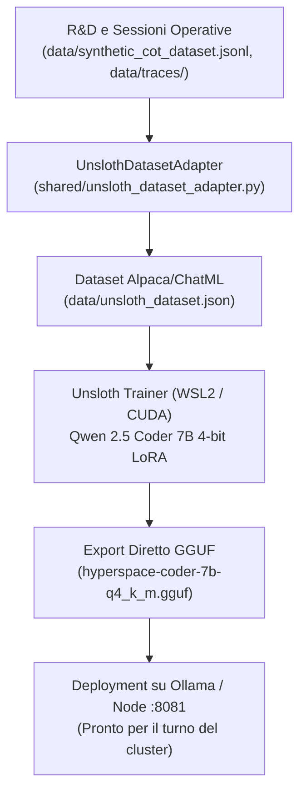

# HyperSpace Sovereign LoRA Refinery con Unsloth

Questo documento descrive l'architettura e la pipeline per il **fine-tuning continuo e autonomo dei modelli locali** del cluster HyperSpace AGI 1.05 tramite **Unsloth** (`unslothai/unsloth`).

---

## 1. Il Ruolo nel Cluster

Nel cluster multi-nodo eterogeneo di HyperSpace:
* **Mac M5 Hub:** Control plane, telemetry, orchesrazione e runtime Python leggero per test (nessuna dipendenza CUDA/Triton).
* **ASUS V16:** Inferenza rapida con Flint 40B MoE e routing tool.
* **HP OMEN 16 (NVIDIA RTX 3070 Laptop, 8 GB VRAM):** Host ideale per la **LoRA Refinery** sotto ambiente **WSL2 / Linux**, sfruttando l'accelerazione hardware nativa CUDA e i kernel Triton di Unsloth.



---

## 2. Perché Unsloth (e Limiti Hardware 8 GB VRAM)

* **Efficienza Estrema:** Unsloth implementa kernel Triton scritti a mano che riducono l'uso di VRAM del 70-80% e accelerano l'addestramento da 2 a 5 volte rispetto a HuggingFace standard.
* **Perimetro Modelli:**
  - ✅ **Supportati e raccomandati su 8 GB VRAM:** Modelli da 7B a 9B in QLoRA 4-bit (`Qwen2.5-Coder-7B`, `Llama-3.1-8B`, `Granite-3.3-8B`, `Gemma-2-9B`).
  - ❌ **Non supportati su 8 GB VRAM:** Modelli da 24B o 40B (richiedono 24-48 GB VRAM per l'addestramento).
* **Nessun inquinamento su macOS:** Unsloth e i pesanti pacchetti CUDA/Triton rimangono confinati nel sottosistema WSL2 dei laptop Windows.

---

## 3. Componenti Implementati

1. **[`shared/unsloth_dataset_adapter.py`](file:///Users/opo/hyperspace-agi-1.04/shared/unsloth_dataset_adapter.py):**
   Estrae i CoT verificati, i prototipi con AST 100% valido e le tracce tool positive da `data/traces/*.ndjson`, assemblandoli in formato Alpaca standard con prompt di sistema sovrano.
2. **[`scripts/unsloth/train_hyperspace_lora.py`](file:///Users/opo/hyperspace-agi-1.04/scripts/unsloth/train_hyperspace_lora.py):**
   Script di fine-tuning parametrico ottimizzato per 8 GB VRAM:
   - Quantizzazione base a 4-bit (`load_in_4bit=True`).
   - Adapter LoRA rank 16 su tutti i moduli di proiezione.
   - Batch size 2, gradient accumulation 4, optimizer `adamw_8bit`.
   - Esportazione finale in formato `.gguf` quantizzato (`q4_k_m`) e generazione automatica del `Modelfile` per Ollama.
3. **[`scripts/unsloth/run_omen_wsl2_training.ps1`](file:///Users/opo/hyperspace-agi-1.04/scripts/unsloth/run_omen_wsl2_training.ps1):**
   Launcher PowerShell per lanciare la pipeline con un solo comando da Windows dentro WSL2.

---

## 4. Guida Rapida all'Uso su HP OMEN 16

### A. Preparazione Ambiente (una tantum su WSL2 Ubuntu)
```bash
wsl -d Ubuntu
pip install "unsloth[colab-new] @ git+https://github.com/unslothai/unsloth.git"
pip install --no-deps trl peft accelerate bitsandbytes
```

### B. Generazione Dataset & Avvio Addestramento
Da PowerShell su HP OMEN:
```powershell
.\scripts\unsloth\run_omen_wsl2_training.ps1 -Model "unsloth/Qwen2.5-Coder-7B-Instruct-bnb-4bit" -Epochs 1
```

Oppure manualmente da terminale:
```bash
# 1. Estrazione dataset
python -c "from shared.unsloth_dataset_adapter import UnslothDatasetAdapter; UnslothDatasetAdapter().export_alpaca_json('data/unsloth_dataset.json')"

# 2. Addestramento ed export GGUF
python scripts/unsloth/train_hyperspace_lora.py --dataset data/unsloth_dataset.json --epochs 1
```

### C. Caricamento Istantaneo su Ollama
Una volta completato l'export:
```bash
cd data/lora_models/hyperspace-qwen-7b/gguf
ollama create hyperspace-coder:7b -f Modelfile
```
Il nuovo modello sarà immediatamente disponibile per tutte le missioni del cluster.
